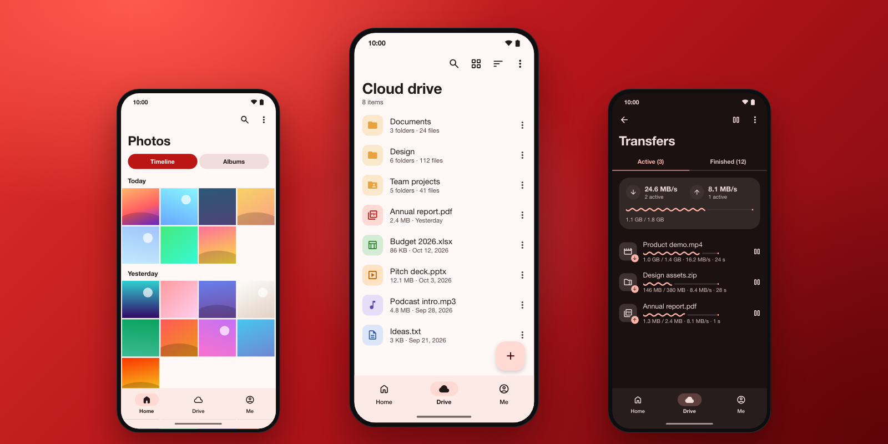

<div align="center">


# MegaGlass

**Open-source MEGA cloud client for Android.**<br>
End-to-end encrypted, fast and private. No ads, no tracking, no Google Play Services.

[](#build)
[](https://github.com/meganz/sdk)
[](https://github.com/Turtlecute33/MegaGlass-Android/releases)



</div>

## About

MegaGlass is an unofficial client for [MEGA](https://mega.io) cloud storage on Android 15 and
later. It uses the official MEGA SDK (C++, BSD-2) for encryption and transfers, and Jetpack
Compose with Material 3 Expressive for the interface. Chat and calls are not included.

## Features

- **Cloud drive**: browse, search, sort, label, move, copy and rename files and folders.
- **Fast transfers**: 8 parallel connections in each direction and larger requests on devices
  with more RAM.
- **Photos**: timeline, albums and camera uploads.
- **Sync and offline**: two-way folder sync, and files that stay available without a network.
- **Sharing**: shared folders, public links and contacts. Open MEGA links in the app.
- **Viewers**: images, video, audio and text, with a text editor.
- **App lock**: passcode lock and screenshot blocking.
- **Themes**: light, dark, pure black and dynamic colour.

## Privacy

- No analytics, no ads, no telemetry, no Google Play Services. The app connects only to MEGA.
- Files are encrypted on the device before upload.
- The session is encrypted with a key in the Android Keystore and is not included in backups.
- Thumbnails, previews and offline files stay in app-private storage.
- The app passcode is stored only as a salted PBKDF2 hash.

## Download

Get the APK from [Releases](https://github.com/Turtlecute33/MegaGlass-Android/releases).
MegaGlass is alpha software. Keep a copy of important files.

## Build

Requirements: Android SDK with platform 37 and NDK 28, JDK 21, Homebrew packages
`cmake ninja swig autoconf automake autoconf-archive libtool pkg-config`.

```sh
scripts/bootstrap-sdk.sh      # fetches MEGA SDK v10.21.0 and vcpkg, applies patches/
scripts/build-sdk.sh          # builds libmega.so (arm64-v8a) and the Java bindings into :sdk
./gradlew :app:assembleDebug  # or assembleRelease after scripts/make-release-key.sh
```

The first SDK build compiles all native dependencies with vcpkg and takes a while. Later builds
use them again.

<details>
<summary><b>Native SDK changes</b></summary>

- `patches/mega-sdk-android-request-size.patch`: the SDK limits each transfer request to 2 MB on
  Android. The patch scales the limit with device RAM (up to 16 MB, the desktop value). This
  decreases the overhead of each request on fast connections.
- `patches/mega-sdk-java-factory-ownership.patch`: marks allocating JNI factories and album
  getters as owners of their native results, so that Java can release them safely.
- `scripts/ports/`: pinned native dependency updates, with upstream provenance and licenses.
  The native build records versions and a binary digest. Gradle rejects artifacts that do not
  match.
- The app sets 8 parallel connections in each direction (SDK mobile default: 4 down, 3 up). This
  is the "Fast transfers" setting.
- Crypto++ and OpenSSL are built with the ARMv8 AES, PMULL and SHA instructions. The libraries
  select them at run time.

</details>

<details>
<summary><b>Project layout</b></summary>

- `sdk/`: SDK bindings (`src/main/java` is generated, `src/main/glue` is hand-written).
- `app/src/main/kotlin/app/megaglass/android/core`: SDK wrapper, session, transfers, storage.
- `app/src/main/kotlin/app/megaglass/android/ui`: theme, shared components, navigation.
- `app/src/main/kotlin/app/megaglass/android/feature`: one package for each feature.
- `scripts/fetch-icons.py`: makes the Material Symbols drawables again.

</details>

<details>
<summary><b>Validation</b></summary>

After you build the native SDK, run the JVM regression tests, lint and the two application
builds:

```sh
./gradlew :app:testDebugUnitTest :app:lintDebug :sdk:lintDebug \
  :app:assembleDebug :app:assembleRelease
```

With an Android 15 or later arm64 emulator connected, run
`./gradlew :app:connectedDebugAndroidTest`. These tests use isolated fixture data and do not
need a MEGA account. Workflows that need a login still need a dedicated test account.

The [alpha audit](docs/ALPHA_AUDIT.md) lists the fixes and the remaining test gaps. The
[validation record](docs/ALPHA_AUDIT_VALIDATION.md) has the measured results and artifact hashes.

</details>

---

<sub>MegaGlass is an independent project. It is not affiliated with or endorsed by MEGA.</sub>
